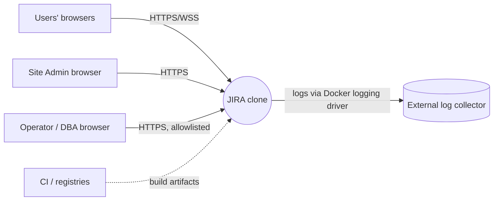
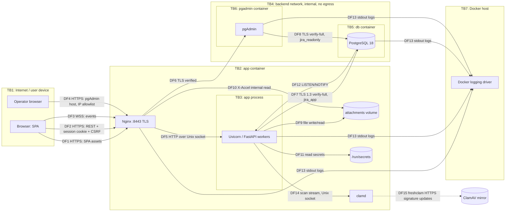

# Threat Model — Detailed

- **Method:** Shostack's Four Question Framework; STRIDE-per-element for Question 2.
- **Version:** 0.1 (design-time, before implementation). Final version is produced in WP-26.
- **System:** JIRA clone, 3-container Docker deployment (PLAN §3).
- **Related:** `summary.md` (short version), `../security-requirements.md`, `../../decisions/`, `../testing/security-test-plan.md`.

### Maintenance rules
- Any WP that adds or changes an entry point, data flow, trust boundary, asset, or mitigation updates this file in the same
  change, bumps the version, and adds a changelog line (§6).
- Threat IDs (`T-xxx`) are permanent; retired threats keep their ID with status `Retired`.
- Every threat's mitigation must name the controls (ADR / requirement section) and the verification test case (`TC-…`,
  defined in the security test plan). A threat is **Mitigated** only when its test cases pass.

---

## Question 1 — What are we working on?

### 1.1 System description
A self-hosted, multi-user agile issue tracker. Users authenticate with a password plus mandatory MFA, then work in projects
(issues, boards, sprints, comments, attachments). A Site Admin manages users. An operator runs the Docker host and may use
pgAdmin for database administration.

### 1.2 Assets

| ID | Asset | C | I | A | Notes |
|---|---|---|---|---|---|
| AS-1 | Project content: issues, comments, history, attachments | H | H | M | Business-confidential |
| AS-2 | Credentials: password hashes, TOTP seeds, recovery-code hashes, WebAuthn credentials | H | H | M | |
| AS-3 | Session, CSRF and one-time tokens | H | H | L | |
| AS-4 | Authorization state: memberships, roles, site-admin flag | M | H | M | |
| AS-5 | Audit log | M | H | M | Must be tamper-evident |
| AS-6 | Secrets: DB passwords, field-encryption key, app secret key, setup token, TLS private keys | H | H | M | |
| AS-7 | User PII: emails, IPs, user agents | M | M | L | |
| AS-8 | Service availability | — | — | H | |
| AS-9 | Build pipeline and dependencies | M | H | M | Integrity of what we ship |

### 1.3 Actors

| ID | Actor | Trust | Capabilities |
|---|---|---|---|
| AC-1 | Anonymous internet attacker | None | Reaches published HTTPS/HTTP ports |
| AC-2 | Registered user with no project access | Low | Valid session; can create own projects |
| AC-3 | Project Viewer | Low–Med | Read one or more projects |
| AC-4 | Project Member | Med | Write within projects |
| AC-5 | Project Admin | Med | Manage project config and members |
| AC-6 | Site Admin | High | Manage users and settings, read audit log |
| AC-7 | Operator / DBA | Very high | Host, Docker, secrets, pgAdmin |
| AC-8 | Malicious dependency author / compromised registry or CI action | — | Code execution at build or runtime |
| AC-9 | Network attacker on the user's path or the Docker host network | — | Observe/modify traffic |

### 1.4 Entry points

| ID | Entry point | Exposed to |
|---|---|---|
| EP-1 | `https://APP_HOST` static SPA | AC-1+ |
| EP-2 | `/api/v1/auth/*` (setup, register, login, MFA, invite, reset) | AC-1+ |
| EP-3 | `/api/v1/*` authenticated REST | AC-2+ |
| EP-4 | `/api/v1/ws` WebSocket | AC-2+ |
| EP-5 | Attachment upload/download | AC-4+ (upload), AC-3+ (download) |
| EP-6 | `https://PGADMIN_HOST` | Allowlisted networks; AC-7 |
| EP-7 | HTTP port (redirect only) | AC-1 |
| EP-8 | Docker host, `secrets/`, `certs/`, volumes | AC-7 |
| EP-9 | Source repository, CI, package registries | AC-8 |

### 1.5 Data flow diagrams

**Level 0 (context)**

**Level 1 (containers and processes)** — dashed boxes are trust boundaries.

Build-time (TB8, supply chain): source repo → CI (GitHub Actions) → dependencies from PyPI/npm, base images from Docker Hub →
app image. Covered by threats T-033 and T-034.

### 1.6 Trust boundaries

| ID | Boundary | What crosses it | Primary controls |
|---|---|---|---|
| TB1→TB2 | Internet ↔ Nginx | All user traffic | TLS, HSTS, headers, rate limits, size limits, Host allowlist |
| TB2→TB3 | Nginx ↔ application process | Proxied requests | Unix socket perms, header overwrite, app authN/authZ |
| TB3→TB5 | App ↔ database | SQL | TLS verify-full, client certificate + SCRAM, least-privilege role, parameterized queries, statement timeout |
| TB1→TB6 | Operator ↔ pgAdmin (via Nginx) | Admin sessions | Separate hostname, IP allowlist, TLS both legs, pgAdmin auth, read-only default role |
| TB6→TB5 | pgAdmin ↔ database | SQL | TLS verify-full, client certificate + SCRAM, `jira_readonly` |
| TB2/5/6→TB7 | Containers ↔ host | Syscalls, volumes, secrets, logs | Non-root, cap_drop, no-new-privileges, read-only rootfs, internal network |
| Origin boundary | `APP_HOST` origin ↔ `PGADMIN_HOST` origin ↔ other sites | Browser scripts, cookies | `__Host-` cookies, SameSite=Strict, CSP, separate hostnames, frame-ancestors none |
| TB8 | Outside code ↔ our build | Dependencies, actions, images | Lockfiles, digests, SHA-pinned actions, SCA, SBOM |

### 1.7 Assumptions
- AS-A1 The Docker host and its administrators are trusted (AC-7 is out of the attacker model except as an insider risk; see T-031).
- AS-A2 Operators follow the deployment requirements D1–D8 (security-requirements §16).
- AS-A3 Browsers are current and support SameSite, CSP Level 3, and `__Host-` cookies.
- AS-A4 The host clock is NTP-synchronized.
- AS-A5 No outbound network features exist in v1 (no webhooks, link previews or remote images).

---

## Question 2 — What can go wrong?

Likelihood (L) and Impact (I) are rated Low/Medium/High **before** mitigation; the risk is the higher of the two, adjusted down
by one level if both are not High. Status values: `Planned` (design-time), `Mitigated` (tests pass), `Accepted`, `Transferred`, `Retired`.

### 2.1 Spoofing

| ID | Threat | Element | L | I | Risk | Mitigations | ASVS | Tests | Status |
|---|---|---|---|---|---|---|---|---|---|
| T-001 | Password brute force against one account | EP-2, DF2 | H | H | H | Mandatory MFA (ADR-0007); per-account backoff (ADR-0024); 15+ char policy and blocklist (ADR-0013) | V6.1.1, V6.3.1, V6.2.x | TC-A07-01, TC-A07-03 | Planned |
| T-002 | Credential stuffing with leaked passwords | EP-2 | H | H | H | MFA; breached-password check; per-IP limits; stuffing alert | V6.2.12, V6.3.1, V16.3.1 | TC-A07-02, TC-A07-03, TC-A09-03 | Planned |
| T-003 | Phishing of password + TOTP via a real-time relay site | Users | M | H | H | WebAuthn option (origin-bound); HSTS; session rotation; new-session notifications; admin session termination | V6.3.3, V7.4.5 | TC-A07-05 | Planned (residual for TOTP users; see §4) |
| T-004 | Account takeover via password reset or MFA reset (incl. social engineering of an admin) | Admin flows | M | H | H | Admin-issued single-use 30-minute reset tokens; MFA retained after reset; documented identity proofing; second admin required for own reset; audit (ADR-0022) | V6.4.1, V6.4.3, V6.4.4 | TC-A07-11 | Planned |
| T-005 | Session token theft (XSS, network sniffing, logs, shared computer) | AS-3 | M | H | H | HttpOnly `__Host-` cookie; TLS + HSTS; tokens never logged or put in URLs; idle and absolute timeouts; logout revokes server-side; Clear-Site-Data (ADR-0006/0008) | V3.3.x, V7.3.x, V7.4.1, V14.2.1, V14.3.1 | TC-A04-06, TC-A07-09, TC-A07-10 | Planned |
| T-006 | Session fixation | DF2 | L | H | M | New token at login, after MFA and after step-up; old token revoked | V7.2.4 | TC-A07-08 | Planned |
| T-007 | Attacker reaches `/auth/setup` before the operator and becomes the first admin | EP-2 | M | H | H | Setup requires the secret setup token; single use; disabled once an admin exists | V6.3.2, V6.4.1 | TC-A07-12 | Planned |
| T-008 | User enumeration via login, registration, invite or timing differences | EP-2 | H | L | M | Uniform responses; dummy Argon2 verify for unknown users; generic registration message | V6.3.x | TC-A07-04 | Planned |
| T-009 | MFA bypass: `mfa_pending` session calls normal endpoints | EP-3 | M | H | H | Central session-state gate; enumerated route test | V6.3.3 | TC-A01-10 | Planned |

### 2.2 Tampering

| ID | Threat | Element | L | I | Risk | Mitigations | ASVS | Tests | Status |
|---|---|---|---|---|---|---|---|---|---|
| T-010 | Cross-site request forgery | DF2 | M | H | H | SameSite=Strict; double-submit token bound to session; Origin check; no state-changing GET (ADR-0009) | V3.3.2, V3.5.1, V3.5.3 | TC-A01-08 | Planned |
| T-011 | Cross-site WebSocket hijacking | DF3 | M | M | M | Origin allowlist at handshake; cookie session; per-event authz (ADR-0016) | V4.4.2 | TC-A01-06 | Planned |
| T-012 | Stored/DOM XSS via rich text, summaries, labels, names, filenames | AS-1, SPA | H | H | H | JSON-only rich text with allowlist schema (ADR-0014); React text rendering; ban on `dangerouslySetInnerHTML`/`eval`; strict CSP; URL scheme allowlist | V1.2.1, V1.2.2, V1.3.1, V3.2.2, V3.4.3 | TC-A05-02, TC-A05-03 | Planned |
| T-014 | JQL injection or search returning other projects' issues | EP-3 | M | H | H | Grammar + parameterized compile + mandatory project filter + limits (ADR-0018) | V1.2.4, V8.2.2 | TC-A05-04, TC-A01-07 | Planned |
| T-015 | Mass assignment / object-property manipulation (`reporter_id`, `project_id`, `is_site_admin`) | EP-3 | M | H | H | Separate Create/Update schemas with `extra="forbid"`; server-controlled fields | V15.3.3, V8.2.3 | TC-A01-03 | Planned |
| T-016 | IDOR: access issues, comments, attachments of other projects by ID | EP-3, EP-5 | H | H | H | Policy check per object in services; repos scoped by project; authz matrix test | V8.2.1, V8.2.2, V8.3.1 | TC-A01-01, TC-A01-02 | Planned |
| T-017 | Privilege escalation (Viewer → Admin, Project Admin → Site Admin, self role change) | AS-4 | M | H | H | Role changes Project-Admin-only; site-admin flag Site-Admin-only; last-admin rules; audit events | V8.2.1, V8.2.3 | TC-A01-05 | Planned |
| T-018 | Race conditions: duplicate issue keys, two active sprints, lost updates | AS-1 | M | M | M | Row locks, partial unique index, optimistic `version` | V2.3.3, V2.3.4 | TC-A06-04 | Planned |
| T-019 | Spoofed `X-Forwarded-For` to dodge rate limits or forge audit IPs; request smuggling | TB1→TB2 | M | M | M | Nginx overwrites forwarding headers; app trusts only the socket; Nginx HTTP/1.1 parsing defaults; no other proxy layer | V4.1.3, V4.2.1, V15.3.4 | TC-A02-11 | Planned |
| T-022 | SQL injection | DF7 | M | H | H | SQLAlchemy bound parameters only; Semgrep rule bans raw SQL with string formatting; least-privilege role | V1.2.4 | TC-A05-01 | Planned |

### 2.3 Repudiation

| ID | Threat | Element | L | I | Risk | Mitigations | ASVS | Tests | Status |
|---|---|---|---|---|---|---|---|---|---|
| T-050 | Attacker with app privileges alters or deletes audit records | AS-5 | M | H | H | `jira_app` INSERT-only; trigger blocks UPDATE/DELETE/TRUNCATE; hash chain + `make audit-verify` (ADR-0012/0019) | V16.4.2 | TC-A08-02, TC-A09-04 | Planned |
| T-051 | Actions can't be attributed to a user | AS-5 | M | M | M | Every mutation records actor; issue history; security event catalogue; no shared accounts | V16.2.1, V16.3.x | TC-A09-01 | Planned |
| T-052 | Log injection / forged log lines | DF13 | M | M | M | JSON-encoded structured logs; control characters escaped | V16.4.1 | TC-A09-05 | Planned |
| T-053 | Logs lost or altered after app compromise | DF13 | M | M | M | Logs leave containers through the Docker logging driver; external collector (D2); audit table in separate container | V16.4.3 | TC-A09-06 | Planned (deployment-dependent) |

### 2.4 Information disclosure

| ID | Threat | Element | L | I | Risk | Mitigations | ASVS | Tests | Status |
|---|---|---|---|---|---|---|---|---|---|
| T-013 | Realtime events delivered to users who lost access | DF3 | M | M | M | Authz re-check per event; payloads contain IDs only; socket closed on revocation | V8.2.2 | TC-A01-06 | Planned |
| T-020 | Eavesdropping/tampering between browser and Nginx | DF1–DF4 | M | H | H | TLS 1.2/1.3, strong suites, HSTS includeSubDomains, no API redirect from HTTP (ADR-0010) | V12.1.x, V12.2.1, V3.4.1, V4.1.2 | TC-A02-02 | Planned |
| T-021 | MITM on internal links (app↔db, Nginx↔pgAdmin, pgAdmin↔db) | DF6–DF8 | L | H | M | TLS with internal CA and full verification; no plaintext fallback; `hostssl` only | V12.3.1–V12.3.4 | TC-A04-04, TC-A02-09 | Planned |
| T-024 | Database dump reveals usable secrets | AS-2, AS-3 | M | H | H | Argon2id hashes; SHA-256 token hashes; AES-256-GCM TOTP seeds with key outside the DB; column grants exclude secrets from `jira_readonly` | V11.4.2, V11.3.x, V14.1.2 | TC-A04-01, TC-A04-03 | Planned |
| T-025 | Stack traces, SQL errors, debug pages or API docs exposed | EP-3 | M | M | M | Generic error handler; docs disabled in production; startup refuses debug in production | V16.5.1, V13.4.2, V13.4.5 | TC-A02-05, TC-A10-01 | Planned |
| T-026 | Secrets or PII written to logs | DF13 | M | H | H | Redaction filter; no query strings on auth routes; tests assert absence | V16.2.5, V14.2.4 | TC-A09-02 | Planned |
| T-027 | Sensitive data cached by browser/proxies or left after logout | Browser | M | M | M | `Cache-Control: no-store` on API; in-memory cache cleared on logout; Clear-Site-Data; no web storage | V14.2.2, V14.3.x | TC-A02-01, TC-A07-09 | Planned |
| T-028 | Existence disclosure of projects/issues/users | EP-3 | M | L | M | 404 for non-members; directory search limited to shared-project users; email hidden by default | V8.2.2, V8.2.3 | TC-A01-04 | Planned |
| T-029 | `.git`, source maps, directory listings, backup files exposed | EP-1 | L | M | M | Image excludes them; `autoindex off`; build without source maps | V13.4.1, V13.4.3, V15.2.3 | TC-A02-04 | Planned |
| T-093 | Clickjacking | SPA | M | M | M | CSP `frame-ancestors 'none'` | V3.4.6 | TC-A02-01 | Planned |

### 2.5 Denial of service

| ID | Threat | Element | L | I | Risk | Mitigations | ASVS | Tests | Status |
|---|---|---|---|---|---|---|---|---|---|
| T-070 | Expensive requests: JQL, Argon2 floods, huge JSON, deep rich text | EP-2, EP-3 | H | M | H | Size/depth limits, rate limits, hashing semaphore, `statement_timeout` (ADR-0018/0024) | V2.4.1, V15.2.2 | TC-A06-01, TC-A10-04 | Planned |
| T-071 | WebSocket connection exhaustion | EP-4 | M | M | M | Per-session socket cap; Nginx `limit_conn`; message size/rate limits | V15.2.2 | TC-A06-01 | Planned |
| T-072 | Disk exhaustion via uploads | EP-5 | M | M | M | Size limits, per-project quota, per-user upload rate | V5.2.1 | TC-A06-01 | Planned |
| T-073 | Attacker deliberately triggers lockouts against real users | EP-2 | M | M | M | Backoff instead of hard lockout; MFA-protected accounts; alerts | V6.3.1 | TC-A07-03 | Planned |

### 2.6 Elevation of privilege and infrastructure

| ID | Threat | Element | L | I | Risk | Mitigations | ASVS | Tests | Status |
|---|---|---|---|---|---|---|---|---|---|
| T-023 | App compromise gives full DB control | TB3→TB5 | L | H | M | `jira_app` without DDL; separate migration role; audit protections | V13.2.2 | TC-A02-09 | Planned |
| T-036 | Stolen DB password used to connect as a service role | TB3→TB5 | L | H | M | Client certificate (CN = role) required in addition to SCRAM; certs mounted only into their service; 90-day rotation (ADR-0012) | V13.2.1, V12.1.3 | TC-A04-07 | Planned |
| T-030 | RCE in Nginx or Uvicorn exposes the other process's secrets (co-located, ADR-0003) | TB2 | L | H | M | Non-root; read-only rootfs; no shell utilities beyond needs; `cap_drop: ALL`; `no-new-privileges`; patched images | V13.2.2, V15.2.1 | TC-A02-06 | Planned (residual accepted — ADR-0003) |
| T-031 | Host compromise or insider reads secret files and volumes | TB7 | L | H | M | File mode 600; disk encryption (D6); vault recommended (D5) | V13.3.1 | review | Accepted (out of scope per AS-A1) |
| T-032 | Container escape via privileged config | TB7 | L | H | M | No privileged containers, no Docker socket mount, dropped capabilities, seccomp default profile | V15.2.3 | TC-A02-06 | Planned |
| T-033 | Malicious/vulnerable dependency or base image | TB8 | M | H | H | Lockfiles with hashes; digests; SCA gates; SBOM; Dependabot; remediation SLAs (ADR-0023) | V15.1.x, V15.2.1 | TC-A03-01..05 | Planned |
| T-034 | CI pipeline compromise (malicious action, leaked tokens) | TB8 | L | H | M | Actions pinned by SHA; least-privilege `permissions`; no long-lived secrets in CI; branch protection (recommended) | V15.1.2 | TC-A03-05 | Planned |
| T-035 | Default or weak credentials (app admin, DB, pgAdmin) | All | M | H | H | No defaults; setup token; generated secrets; startup rejects placeholders | V6.3.2, V13.2.3 | TC-A02-08 | Planned |
| T-040 | pgAdmin reachable from the internet / brute forced | EP-6 | M | H | H | Separate host + IP allowlist; pgAdmin login; Nginx rate limit (ADR-0005) | V13.4.5 | TC-A02-07 | Planned |
| T-041 | Script in pgAdmin origin reads app data or the reverse | Origin boundary | L | H | M | Separate hostnames; `__Host-` cookies; CSP frame-ancestors | V3.5.4 | TC-A02-07 | Planned |
| T-042 | pgAdmin ↔ DB credential sniffing | DF8 | L | H | M | TLS verify-full | V12.3.1 | TC-A04-04 | Planned |
| T-043 | pgAdmin vulnerability or operator mistake modifies production data | EP-6 | L | H | M | Default connection as `jira_readonly`; pinned and patched image; audit of DB connections in Postgres log | V13.2.2 | TC-A02-07 | Planned |

### 2.7 File handling

| ID | Threat | Element | L | I | Risk | Mitigations | ASVS | Tests | Status |
|---|---|---|---|---|---|---|---|---|---|
| T-060 | Uploaded HTML/SVG executes script when viewed | EP-5 | H | H | H | SVG/HTML rejected; `Content-Disposition: attachment`; `nosniff`; sandbox CSP on downloads (ADR-0015) | V1.3.4, V3.2.1, V5.3.1 | TC-A05-08 | Planned |
| T-061 | Path traversal via filename | DF9 | M | H | H | Server-generated storage names; original name metadata only | V5.3.2 | TC-A05-09 | Planned |
| T-062 | MIME confusion / polyglot files | EP-5 | M | M | M | Extension and magic bytes must agree; served with detected type or octet-stream | V5.2.2 | TC-A05-08 | Planned |
| T-063 | Image decompression bombs (avatars), oversized files | EP-5 | M | M | M | Pixel limit; re-encode; size limits; no archive extraction | V5.2.1, V5.2.3 | TC-A06-01 | Planned |
| T-064 | Malware distributed to colleagues through attachments | EP-5 | M | M | M | ClamAV scan before storage; weekly re-scan; downloads forced as attachments; type allowlist; checksums (ADR-0015) | V5.4.3 | TC-A05-11 | Planned (residual: novel malware) |
| T-065 | Antivirus bypass: scanner down, timeout, or archive exceeding limits lets a file through | EP-5 | M | M | M | Fail closed (503 on scanner error); `AlertExceedsMax`; quarantine until clean | V5.2.3, V16.5.3 | TC-A05-11 | Planned |
| T-066 | Tampered antivirus signature update | TB8 | L | M | L | freshclam verifies digitally signed signature files; HTTPS | V15.1.x | review | Planned |

### 2.8 Exceptional conditions and business logic

| ID | Threat | Element | L | I | Risk | Mitigations | ASVS | Tests | Status |
|---|---|---|---|---|---|---|---|---|---|
| T-080 | Fail-open: an exception during authorization or validation lets the request proceed | services | M | H | H | Policy returns deny by default; exceptions map to 500 with rollback; tests inject faults | V16.5.3 | TC-A10-02, TC-A10-05 | Planned |
| T-081 | DB outage leads to insecure fallback (e.g. skipping session checks) | DF7 | L | H | M | No caches that bypass session validation; 503 on DB failure; readiness check | V16.5.2 | TC-A10-03 | Planned |
| T-082 | Malformed input crashes parsers or workers | EP-3, EP-5 | M | M | M | Schemathesis fuzzing; parser error handling; worker restart via supervisord | V16.5.3 | TC-A10-04, TC-A10-06 | Planned |
| T-090 | Workflow or sprint rules bypassed (invalid transition, skipping auth steps) | services | M | M | M | Server-side state machines; transitions table | V2.3.1 | TC-A06-02, TC-A06-03 | Planned |
| T-091 | Mention/notification abuse to probe membership or spam | EP-3 | M | L | M | Mentions only resolve for members; notification rate limits | V2.4.1 | TC-A06-01 | Planned |
| T-092 | Open redirect via post-login `returnTo` | SPA | M | M | M | `returnTo` limited to same-origin relative paths starting with a single `/` | V3.7.2 | TC-A01-11 | Planned |
| T-094 | Prototype pollution in frontend | SPA | L | M | M | `Map`/`Set` for dynamic keys; lint rule; no deep-merge of untrusted objects | V15.3.6 | TC-A05-10 | Planned |

---

## Question 3 — What are we going to do about it?

Every threat above has a mitigation column; this section groups them into controls and maps them to the plan.

| Control | Threats | Where specified | Implemented in WP |
|---|---|---|---|
| Mandatory MFA (TOTP/WebAuthn) | T-001, T-002, T-003, T-009 | ADR-0007 | WP-08 |
| Password policy + breached list | T-001, T-002 | ADR-0013 | WP-07 |
| Rate limiting, backoff and alerts | T-001, T-002, T-070–T-073, T-091 | ADR-0024 | WP-06, WP-07 |
| Opaque server-side sessions, rotation, timeouts | T-005, T-006 | ADR-0006, ADR-0008 | WP-07 |
| CSRF defense in depth | T-010, T-011 | ADR-0009 | WP-06, WP-16 |
| Central authorization policy + route registry + matrix test | T-009, T-013, T-015–T-017, T-028 | security-requirements §5 | WP-06, WP-10 |
| Rich-text schema, CSP, frontend lint bans | T-012, T-093, T-094 | ADR-0014, PLAN §7/§8.2 | WP-01, WP-11, WP-12 |
| Parameterized data access, JQL compiler | T-014, T-022 | ADR-0018 | WP-04, WP-18 |
| TLS everywhere + internal CA | T-020, T-021, T-042 | ADR-0010 | WP-02, WP-03 |
| Crypto at rest (hashing, AES-GCM) | T-024 | ADR-0010 | WP-07, WP-08 |
| Least-privilege DB roles | T-023, T-043, T-050 | ADR-0012 | WP-04 |
| Container hardening + internal network | T-030, T-032 | PLAN §8.3 | WP-03 |
| pgAdmin isolation | T-040–T-043 | ADR-0005 | WP-03 |
| Secrets management, no defaults, setup token | T-007, T-031, T-035 | ADR-0011, ADR-0022 | WP-02, WP-07 |
| Account recovery procedures | T-004 | ADR-0022, security-requirements §4 | WP-07, WP-08 |
| Attachment pipeline incl. antivirus | T-060–T-066, T-072 | ADR-0015 | WP-15 |
| Database mTLS | T-021, T-036, T-042 | ADR-0012 | WP-02, WP-03 |
| Realtime authorization | T-011, T-013, T-071 | ADR-0016 | WP-16 |
| Logging, audit chain, redaction | T-026, T-050–T-053 | ADR-0019 | WP-06 |
| Error handling, fail-closed, transactions | T-025, T-080–T-082 | PLAN §6, security-requirements §6 | WP-06 |
| Supply-chain controls | T-033, T-034 | ADR-0023 | WP-05 |
| Business-logic state machines and limits | T-018, T-090, T-092 | security-requirements §6 | WP-11, WP-13 |

---

## Question 4 — Did we do a good enough job?

### 4.1 Design-time review (v0.1)
- [x] Every element in the Level 1 DFD has at least one threat per applicable STRIDE category.
- [x] Every threat has at least one mitigation, an ASVS reference (where one exists) and a planned test case.
- [x] Every trust boundary has named controls (§1.6).
- [x] Accepted risks are explicit (T-030 residual, T-031, T-064 residual) and tied to ADRs.
- [ ] Mitigations verified by tests — **pending implementation** (WP-06 … WP-21).
- [ ] White-box, black-box and red-team results reconciled against this register — **pending** (WP-22 … WP-24).
- [ ] Threats discovered during testing that were missing here — **to be added in WP-26**, with an analysis of why the model missed them.

### 4.2 Final review checklist (completed in WP-26)
1. For each threat: status is Mitigated (with passing test IDs), Accepted (with ADR), Transferred, or Retired.
2. Compare the red-team attack paths with this register; any successful or partially successful path that isn't covered → new threat + root-cause note on the modeling gap.
3. Compare the black-box findings by Top 10 category with the threats per category.
4. Check that the DFD still matches the deployed system (`docker compose config`, Nginx config, routes list).
5. Record metrics: number of threats by risk, % mitigated, findings found in testing that the model predicted vs missed.
6. Decide: is the residual risk acceptable for an L2 application? Record the decision in the security review and an ADR.

### 4.3 Residual risks (design-time)

| Threat | Residual risk | Why accepted / next step |
|---|---|---|
| T-003 | TOTP users can still be phished through real-time relay | WebAuthn offered; consider making WebAuthn mandatory for Site Admins (candidate ADR) |
| T-030 | Co-located Nginx and app share the container | Required by the 3-container constraint; hardening reduces impact |
| T-031 | Host-level compromise exposes secrets | Out of scope per AS-A1; vault/KMS recommended |
| T-053 | Without an external collector, logs can be lost | Operator requirement D2 |
| T-064 | Signature-based antivirus misses novel malware | Downloads are never rendered or executed by the app; forced as attachments |

---

## 5. STRIDE coverage per element

| Element | S | T | R | I | D | E |
|---|---|---|---|---|---|---|
| Browser/SPA | T-003, T-005 | T-012, T-094 | — | T-027, T-093 | — | T-092 |
| Nginx | T-019 | T-019 | T-052 | T-020, T-029 | T-070, T-071 | T-030 |
| FastAPI app | T-001, T-002, T-004, T-006–T-009 | T-010, T-014–T-018 | T-051 | T-013, T-025, T-026, T-028 | T-070, T-073 | T-016, T-017, T-080 |
| WebSocket | T-011 | T-011 | — | T-013 | T-071 | — |
| PostgreSQL | T-035, T-036 | T-022 | T-050 | T-021, T-024 | T-070 | T-023 |
| pgAdmin | T-040 | T-043 | — | T-041, T-042 | — | T-043 |
| Attachments volume / clamd | — | T-061, T-066 | — | T-060, T-064 | T-072, T-065 | T-062 |
| Secrets | T-035 | — | — | T-031 | — | T-030 |
| Logs / audit | — | T-052 | T-050, T-053 | T-026 | — | — |
| Build pipeline | T-034 | T-033 | — | — | — | T-033 |

---

## 6. Changelog

| Version | Date | Change | By |
|---|---|---|---|
| 0.1 | 2026-10-17 | Initial design-time threat model | orchestrator |
